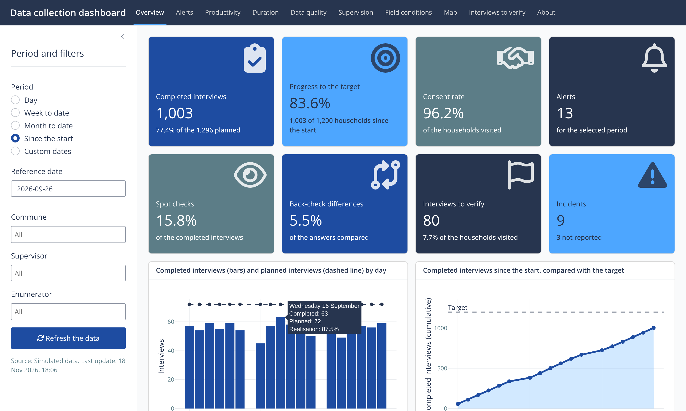
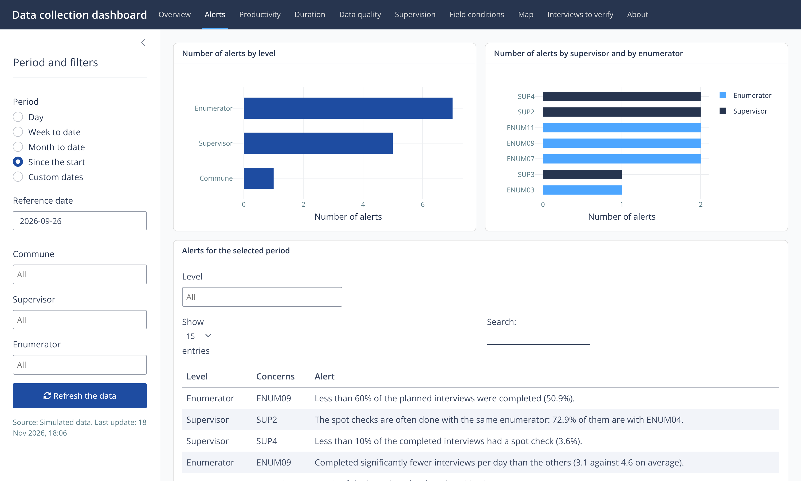

# Data collection dashboard

A Shiny app, written in R, to monitor a household survey while it is in the field. It can use simulated data or read the forms directly from SurveyCTO to follow the fieldwork in real time.



## What the app does

During fieldwork, the data must be checked every day so that problems are corrected while the teams are still in the villages. This dashboard brings the usual checks together in one place. Every plot is interactive: the details appear when the cursor is on a bar, a point or a cell.

| Page | Content |
|---|---|
| Overview | Completed interviews compared with the plan and with the target, consent rate, spot checks, back checks, incidents, number of alerts |
| Alerts | Automatic alerts for the selected period, for all the teams, each supervisor, each enumerator and each commune |
| Productivity | Completed interviews by enumerator and by day, completed compared with planned, comparison with the team over the last 7 days |
| Duration | Duration of the interviews, with the short and long interviews by enumerator |
| Data quality | Missing and "Don't know" answers by question and enumerator, outliers, households submitted more than once |
| Supervision | Spot checks by enumerator and by supervisor, comparison between the first answers and the back-check answers |
| Field conditions | Weather, condition of the road, means of transport, quality of the mobile network by operator, incidents |
| Map | GPS points of the interviews, with the points recorded far from the village |
| Interviews to verify | List of all the problems found, with the reason, to download as a CSV file for the field team |

## Periods and filters

The period can be the day, the week to date, the month to date, the whole fieldwork or custom dates, with a reference date. All the pages can also be filtered by commune, supervisor and enumerator.

## Alerts



The alerts are computed for the selected period:

- less than 60% of the planned interviews completed;
- less than 10% of the completed interviews with a spot check, or more than 60% of the spot checks of a supervisor with the same enumerator;
- an enumerator who completes significantly more or fewer interviews per day than the others;
- more than 10% of short interviews, more than 15% of back-check answers that differ, more than 10% of missing answers to a question;
- 5 interviews or more recorded far from the village;
- any incident, and a mobile network that is good less than half of the time in a commune.

## Data

**The data shown by default are simulated.** The script `simulate_data.R` creates a fictitious survey of 30 villages in 6 communes of Benin, with 12 enumerators in 4 teams and 18 days of fieldwork. No real respondent, enumerator or project is involved.

Problems are added to the data on purpose, so that the checks and the alerts have something to detect: an enumerator who rushes the interviews, one who completes half of the plan, one who records interviews at the same place far from the village, missing answers, outliers, duplicates, a supervisor who always attends the interviews of the same enumerator, incidents that are not reported, and a weak mobile network in two communes.

## Live data from SurveyCTO

The app reads SurveyCTO directly when the connection is defined, so there is no file to download. The data are read again every 10 minutes and when the user clicks on "Refresh the data".

1. Install the package: `install.packages("rsurveycto")`.
2. Copy `.Renviron.example`, name the copy `.Renviron`, and fill in the server name, the user, the password and the identifiers of the forms. Restart R.
3. In `surveycto.R`, replace the names of the fields with the names used in the forms.
4. Run the app. The source shown under the filters becomes "SurveyCTO".

The SurveyCTO user needs the permission to use the API. The file `.Renviron` contains a password and must never be uploaded to GitHub: it is listed in `.gitignore`. An app that shows real survey data must not be published without access control.

## Settings

The file `config.R` contains everything that changes from one survey to another:

- the words used for the field staff: `agent_label` ("Enumerator" or "Monitor") and `team_label` ("Supervisor" or "Bloc");
- the colours;
- the thresholds of the checks and of the alerts;
- the time between two readings of the data.

## How to run

Install the required R packages:

```r
install.packages(c("shiny", "bslib", "dplyr", "ggplot2", "plotly", "DT", "leaflet"))
```

Open `app.R` in RStudio and click **Run App**, or run:

```r
shiny::runApp()
```

The simulated data are already in the folder `data`. To create them again, run `simulate_data.R`.

## Files

| File | Content |
|---|---|
| `app.R` | The Shiny app: user interface and server |
| `config.R` | Settings: words, colours, thresholds |
| `checks.R` | Functions of the data quality checks and of the alerts |
| `surveycto.R` | Reading of the forms from SurveyCTO |
| `simulate_data.R` | Script that creates the simulated data |
| `data/interviews.csv` | One row per household visited |
| `data/daily_reports.csv` | One row per enumerator and per day: plan, field conditions, incidents |
| `data/back_checks.csv` | Answers collected again for 15% of the completed interviews |
| `data/villages.csv` | Villages, with their target and the GPS point of their centre |
| `.Renviron.example` | Example of connection settings for SurveyCTO |
| `images/` | Screenshots used in this page |
